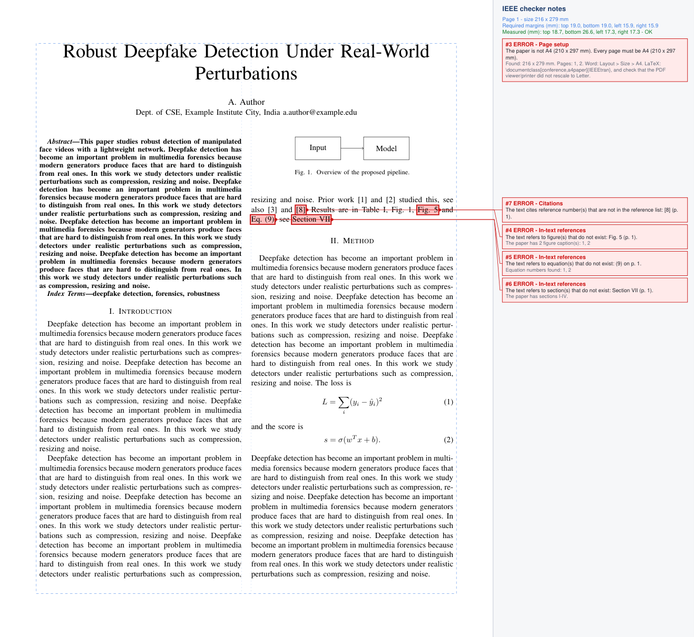
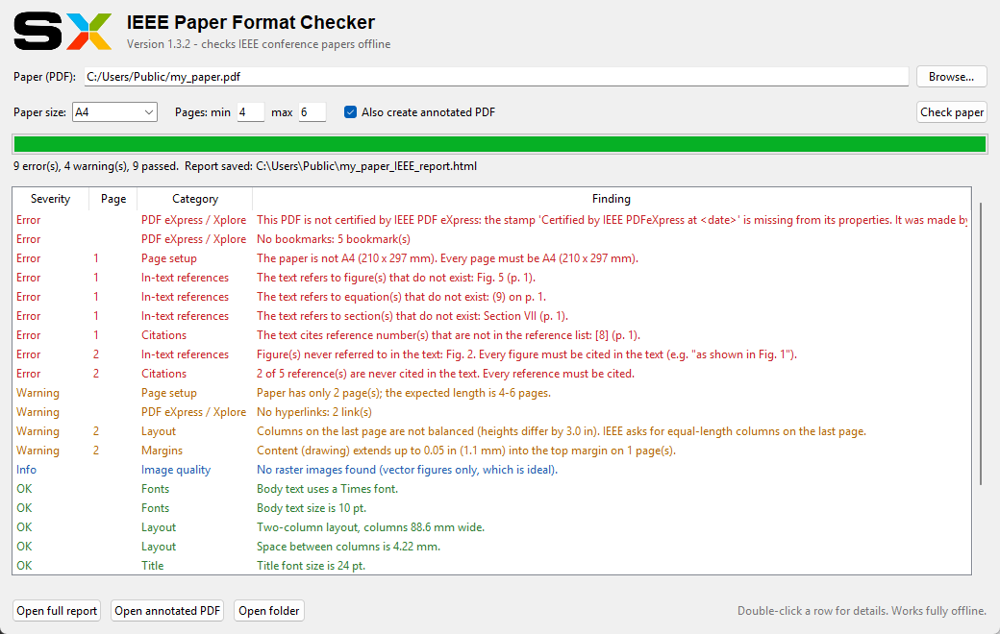

<div align="center">


# IEEE Paper Format Checker

**Check your IEEE conference paper before you submit it.**<br>
A free desktop app that finds formatting problems in your PDF in seconds and shows exactly where they are.<br>
It works offline, so your paper never leaves your computer.

[](https://shubhams-work.github.io/IEEE-conference-/)

[](https://github.com/shubhams-work/IEEE-conference-/releases/latest)
[](https://github.com/shubhams-work/IEEE-conference-/actions/workflows/build.yml)


[**Download**](https://shubhams-work.github.io/IEEE-conference-/) ·
[What it checks](#what-it-checks) ·
[How to use](#how-to-use) ·
[For conference organisers](#for-conference-organisers) ·
[Build from source](#build-from-source)



</div>

---

## Download

Get the installer for your system from the **[download page](https://shubhams-work.github.io/IEEE-conference-/)** or the **[latest release](https://github.com/shubhams-work/IEEE-conference-/releases/latest)**. Each installer includes everything it needs, so you don't need to install Python or anything else.

| System | File | Install |
|---|---|---|
| **Windows 10 / 11** | `IEEE-Paper-Checker-Setup-<version>.exe` | Double-click → **Next → Install**. No admin rights needed. If *"Windows protected your PC"* appears: **More info → Run anyway**. |
| **macOS · Apple silicon** (M1–M4) | `IEEE-Paper-Checker-<version>-macOS-arm64.dmg` | Open, drag the app to **Applications**. First start: open it once, then **System Settings → Privacy & Security → Open Anyway**. |
| **macOS · Intel** | `IEEE-Paper-Checker-<version>-macOS-x86_64.dmg` | Same as above. Not sure which Mac you have? Apple menu → *About This Mac*. |
| **Ubuntu / Debian / Mint** | `ieee-paper-checker_<version>_amd64.deb` | Double-click, or `sudo apt install ./ieee-paper-checker_<version>_amd64.deb` |
| **Other Linux** | `IEEE-Paper-Checker-<version>-linux-x64.tar.gz` | Unpack and run `./install.sh` (no sudo). |

> The app is free and not signed by Microsoft or Apple, so your computer asks once whether you trust it. Every installer is built and tested automatically on real Windows, macOS (Apple silicon and Intel) and Linux machines before it is published.

## What it checks

| Area | Checks |
|---|---|
| 📄 **Page setup** | A4 (210 × 297 mm) on **every page**, page limit, blank pages |
| 📐 **Margins & columns** | Top/bottom 19 mm, left/right 16 mm on every page; two columns with a 4.22 mm gap; balanced last page |
| 🔗 **Citations** | Every reference is cited as [n]; every [n] exists in the list; no duplicates; numbered in order of first citation; no author-year style |
| 🧭 **In-text references** | Every figure and table is mentioned in the text; no mentions of a *Fig. 7*, *Eq. (9)* or *Section VII* that doesn't exist |
| ✅ **IEEE PDF eXpress** | The *"Certified by IEEE PDFeXpress at …"* stamp is present and the PDF wasn't changed after certification |
| 🗂️ **IEEE Xplore file rules** | Fonts embedded and subset, no Type 3 fonts, no security, bookmarks, links, attachments, JavaScript, forms or comments; PDF 1.3–1.7 |
| 📊 **Tables** | Tables must be real tables, not **pasted pictures**; screenshots of tables or text are detected |
| 🖼️ **Image quality** | Photos ≥ 300 dpi, diagrams ≥ 600 dpi at printed size; **upscaled or blurry** images; diagrams saved as JPEG |
| 🔤 **Fonts & style** | Times 10 pt body, 24 pt title, 9 pt abstract, 8 pt captions and references; Roman-numeral headings; `Fig. N.` and `TABLE I` captions |
| 🧹 **Leftovers** | Template placeholder text, unresolved `??` / `[?]`, Word *"Error! Reference source not found"*, page numbers, headers, arXiv stamps |

## How to use

1. Open **IEEE Paper Format Checker**. On Windows you can also right-click a PDF and choose **Check IEEE format**.
2. Choose your PDF and press **Check paper**.
3. You get three results, saved next to your PDF:

| Result | What it shows |
|---|---|
| **The app window** | Every problem: red = error (must fix), orange = warning, green = passed. Double-click a row for details. |
| **Annotated PDF** (`…_IEEE_annotated.pdf`) | Summary pages with a numbered list of problems and how to fix them. Each page then gets a **notes panel**: every problem is highlighted at its exact spot and linked to its note. |
| **HTML report** (`…_IEEE_report.html`) | Full report with pictures, a citation table, an in-text reference table, the PDF eXpress checklist, measured margins and every image's dpi. |

<p align="center">
  
</p>

### Command line

```bash
ieee-check paper.pdf                            # Windows: ieee-check.exe
ieee-check paper.pdf --min-pages 4 --max-pages 6
ieee-check paper.pdf --paper letter             # require US Letter instead of A4
ieee-check *.pdf --out reports/ --json          # check many papers, JSON output
```

The exit code is `1` when errors are found, so it can be used in scripts.

### About the IEEE PDF eXpress check

Every paper approved by [IEEE PDF eXpress](https://ieee-pdf-express.org) contains the text *"Certified by IEEE PDFeXpress at MM/DD/YYYY HH:MM:SS AM/PM"* in its document properties (Acrobat Reader: *File → Properties*). If the stamp is missing, the paper didn't go through eXpress. If the approved file was edited, re-saved, compressed or merged afterwards, its last-modified date no longer matches its creation date, and the checker reports that. **Submit exactly the file eXpress e-mailed back.**

### LaTeX users

The standard IEEEtran class with `a4paper` uses about 14.3 mm side margins, narrower than the 16 mm required by the default rules. Add:

```latex
\usepackage[a4paper,top=0.75in,bottom=0.75in,left=0.625in,right=0.625in,columnsep=4.22mm]{geometry}
```

Remove `hyperref`, or use `\usepackage[draft]{hyperref}`, because IEEE Xplore PDFs must not contain bookmarks or links.

## For conference organisers

All rules are in the **CONFERENCE PROFILE** block at the top of [`ieee_checker/spec.py`](ieee_checker/spec.py):

```python
REQUIRED_PAPER = "a4"           # "a4", "letter" or "auto"
MIN_PAGES = 4
MAX_PAGES = 6
CONF_MARGINS = {"top": 0.75 * INCH, "bottom": 0.75 * INCH, "left": 0.625 * INCH, "right": 0.625 * INCH}
COLUMN_GAP = 4.22 * MM
REQUIRE_PDF_EXPRESS = True
UNCITED_REFERENCE_IS_ERROR = True
```

Change the values, push to GitHub, and new installers for every platform are built, tested and published automatically (see below). Authors can also change the paper size and page range in the app for a single check.

| Rule | Default requirement | If broken |
|---|---|---|
| Paper size | A4 on every page | Error |
| Margins | 19 mm top/bottom, 16 mm left/right | Error (> 3 mm) / Warning |
| Columns | Two, 4.22 mm apart (4.0–5.8 mm accepted) | Error / Warning |
| Length | 4–6 pages | Error above max, Warning below min |
| Citations | All references cited, all citations exist | Error |
| In-text references | All figures/tables mentioned, none missing | Error |
| PDF eXpress | Certified and unmodified | Error |
| Xplore file rules | Fonts, security, bookmarks, version … | Error (links / subsetting: Warning) |

## Build from source

<details>
<summary><b>Automatic builds on GitHub (all platforms)</b></summary>

[`.github/workflows/build.yml`](.github/workflows/build.yml) runs on every push to `main` and on version tags. For each platform it:

1. builds the installer: Windows `Setup.exe` (Inno Setup), macOS `.dmg` for Apple silicon and Intel, Linux `.deb` and `.tar.gz`
2. **installs it** on a clean machine, like a user would
3. runs [`tests/ci_check.py`](tests/ci_check.py): the installed app must find every problem planted in `tests/samples/sample_errors.pdf`, pass the clean sample, and write the report and annotated PDF
4. opens the app window with a paper and checks that it runs the check by itself

Pushing a tag such as `v1.4.0` (after updating `ieee_checker/__init__.py`) publishes the tested installers as a GitHub Release. The [download page](https://shubhams-work.github.io/IEEE-conference-/) always offers the latest release.

</details>

<details>
<summary><b>Build an installer on your own computer</b></summary>

A computer can only build its own system's installer:

| System | Requirements | Command |
|---|---|---|
| Windows | Python 3.9+, [Inno Setup](https://jrsoftware.org/isdl.php) 6 or 7 | `build_windows.bat` |
| macOS | Python 3.9+ from python.org | `./build_mac.sh` |
| Linux | `sudo apt install python3-venv python3-tk binutils` | `./build_linux.sh` |

The installers are written to `dist/`.

</details>

<details>
<summary><b>Run from source</b></summary>

With Python 3.9+ installed, double-click `run_windows.bat` or `run_mac.command`, or run `./run_linux.sh`. The first run installs PyMuPDF, NumPy and Pillow (internet needed once); after that it works offline.

</details>

<details>
<summary><b>Project structure</b></summary>

```
ieee_checker/
  analyzer.py      all checks (layout, fonts, citations, references, eXpress, Xplore rules)
  imagecheck.py    image resolution, upscaling/blur, table-screenshot detection
  report.py        HTML report
  annotate.py      annotated PDF (summary pages + notes panel)
  app.py           desktop window and command line
  spec.py          conference rules (edit this)
installer/         icons, PyInstaller spec, Inno Setup script, Linux packaging
tests/             end-to-end test and sample papers
docs/              download page (GitHub Pages)
```

</details>

## Limits

These are automatic checks of what can be measured in the PDF. They complement, and don't replace, your conference's author instructions and IEEE PDF eXpress. Table and image detection uses heuristics, so if a result looks wrong, look at the highlighted spot in the annotated PDF.

<div align="center">
<sub>Not affiliated with or endorsed by IEEE.</sub>
</div>
